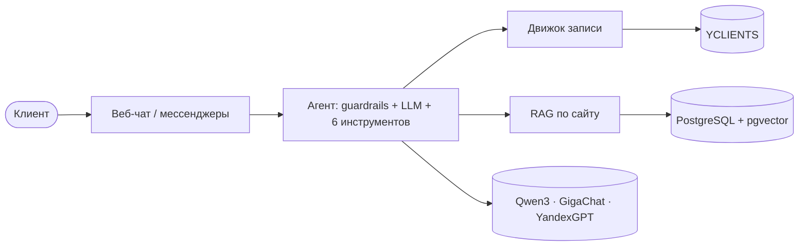

# beauty-agent

[](https://github.com/Bananas1631/Ai-beauty-agent/actions/workflows/ci.yml)
[](https://github.com/Bananas1631/Ai-beauty-agent/actions/workflows/evals.yml)

ИИ-администратор для салонов красоты: круглосуточно отвечает клиентам в мессенджерах и на сайте,
консультирует по услугам и сам записывает к мастеру через YCLIENTS.

> Статус: в разработке, октябрь 2026 — январь 2027.

## Проблема

- Клиенты пишут вечером и в выходные, а администратор отвечает в рабочее время и между звонками — часть заявок теряется.
- Большинство сообщений — одни и те же вопросы: цены, свободные окна, адрес, подготовка к процедуре.
- Запись переносится из переписки в CRM вручную — отсюда ошибки и двойные записи.

## Как это работает

Агент на LLM ведёт разговор, а факты даёт код: цены — из каталога салона, свободное время — из YCLIENTS,
запись — по номеру предложенного варианта и ровно один раз. Вопросы о салоне — гибридный поиск по его сайту.
Медицина, жалобы, скидки и сбои — администратору. Подробно — [docs/architecture.md](docs/architecture.md),
решения — [docs/adr/](docs/adr/).



## Быстрый старт

Нужны Python 3.12, [Poetry 2.x](https://python-poetry.org/docs/#installation), Docker и GNU Make
(на Windows: `winget install ezwinports.make`).

```bash
git clone https://github.com/Bananas1631/Ai-beauty-agent.git && cd Ai-beauty-agent
cp .env.example .env
make install   # зависимости и git-хуки
make chat      # чат с агентом в терминале на фейковом CRM — работает без ключей и без Docker
```

Страница салона с чатом:

```bash
make up && make migrate && make seed   # затем http://localhost:8000/s/demo-lavanda
```

Без ключей LLM отвечает офлайн-модель на правилах; с ключом (`LLM_CLOUDRU_API_KEY` и другие в `.env`) —
настоящая модель. Все команды — `make help`.

## Качество

| Что | Как измеряется | Сейчас |
|---|---|---|
| Запись на верную услугу и время | evals: 100 сценариев `booking/v2` | 93% — офлайн-модель на правилах; живые модели — ADR 007 |
| Передача администратору | evals: медицина, жалобы, скидки | 100% |
| Инварианты: нет записи на непредложенное время, нет цены вне каталога, провокации не срабатывают | evals + 30 провокаций `attacks/v1`, гейт в CI | 100% |
| Поиск по сайту салона | recall@5 на 30 вопросах `rag/v1` | 100%, MRR 0,92 (офлайн-эмбеддинги) |
| Стоимость диалога, p95 | evals с живой моделью | после прогона с ключами |
| Время ответа под нагрузкой, p95 | Locust: 50 салонов в пиковый час, 120 пользователей, LLM ~1,5 с и CRM ~0,3 с на фейках | ответ агента 5,8 с, вебхук 17 мс, страница салона 22 мс |
| Тесты | pytest: юнит, интеграционные на PostgreSQL и Redis, контрактные, e2e | покрытие 90% |

Отчёты — [evals/reports/](evals/reports/). Пороги гейта — [evals/thresholds.toml](evals/thresholds.toml).
Нагрузка и планы запросов — [docs/performance.md](docs/performance.md), аварии — [docs/runbook.md](docs/runbook.md).

## Стек

| Слой | Технологии |
|---|---|
| Язык и качество кода | Python 3.12, Poetry, ruff, mypy (strict), pytest, hypothesis, pre-commit, gitleaks, pip-audit |
| API | FastAPI, Pydantic, WebSocket, Jinja2 |
| Данные | PostgreSQL 17 + pgvector, SQLAlchemy 2 (async), Alembic, Redis |
| Агент | свой цикл (ADR 005), function calling, Qwen3 · GigaChat · YandexGPT, роутер с резервной моделью |
| RAG | обход сайта без SSRF, нарезка с перекрытием, bge-m3, HNSW + полнотекст, RRF |
| Качество ИИ | evals с гейтом в CI, LLM-судья, Langfuse (self-hosted в РФ) |
| Интеграции | YCLIENTS REST API: лимит 5 rps, повторы, circuit breaker |
| Инфраструктура | Docker, GitHub Actions, GHCR, VPS в РФ, Caddy, Sentry / GlitchTip |

## Данные и секреты

В репозитории нет реальных данных салонов и клиентов: тесты и evals работают на вымышленных данных.
Ключи и пароли — только в `.env` (не попадает в git); gitleaks проверяет каждый коммит.
Телефоны и e-mail маскируются в логах, Sentry и трассах; бэкапы шифруются (152-ФЗ).

## Лицензия

© 2026 Maksim Lyubchenko. Все права защищены. Код открыт для ознакомления; использование — с письменного разрешения автора.
