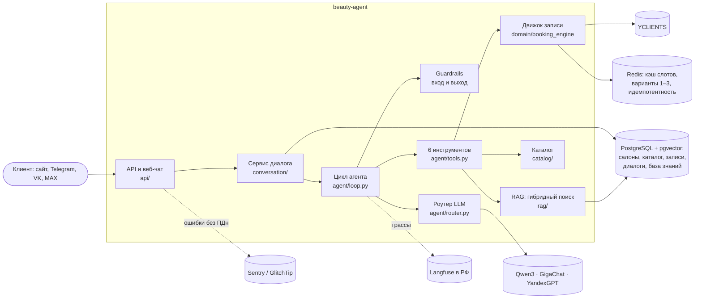

# Архитектура beauty-agent

Модульный монолит на FastAPI (ADR 001): один сервис с чёткими модулями, PostgreSQL и Redis.
Код делится на слои: адаптеры внешних систем → домен → агент → API.

## Путь сообщения клиента

1. **Веб-чат** (`api/widget_ws.py`): Origin салона, лимиты на сессию и IP, одно сообщение за раз.
2. **Сервис диалога** (`conversation/service.py`): клиент по «канал + ID», диалог, блокировка в Redis,
   защита от повторного вебхука, дневной бюджет салона на LLM.
3. **Входные guardrails** (`agent/guardrails.py`): длина, prompt injection, здоровье, жалобы
   и скидки — без вызова модели, сразу ответ или администратор.
4. **Контекст** (`agent/context.py`): промпт v1, профиль клиента, резюме, данные инструментов,
   последние 4 реплики — в пределах 3 500 токенов.
5. **Цикл** (`agent/loop.py`): LLM → инструменты → LLM, не больше 6 шагов. Аргументы проверяет
   Pydantic; кривой JSON — одна попытка исправиться; дальше — администратор.
6. **Инструменты**: цены и мастера — из каталога в БД; время — из CRM через движок записи (2–3 варианта
   под номерами в Redis); запись — по номеру варианта, ровно один раз (ключ идемпотентности, перепроверка
   слота, ограничение исключения в БД); сведения о салоне — гибридный поиск по сайту.
7. **Выходные guardrails**: иероглифы — перегенерация; цены и время, которых нет в данных инструментов, —
   безопасный ответ вместо выдумки.
8. **Сохранение**: сообщения с токенами и стоимостью, журнал вызовов инструментов, резюме; состояние
   диалога в Redis на 24 часа с восстановлением из PostgreSQL.

## Принципы

- **Факты даёт код, модель только разговаривает** (ADR 006): цена, время и запись не зависят от модели.
- **Изоляция салонов**: `salon_id` в каждом запросе подставляет репозиторий; поиск по знаниям — тоже.
- **152-ФЗ**: данные и модели в РФ, телефоны и e-mail маскируются в логах, Sentry и трассах,
  бэкапы шифруются, согласия хранятся с версией документа.
- **Деградация, а не падение**: CRM недоступна — заявка администратору; модель недоступна — резервная,
  затем администратор; сайт салона недоступен — знания из карточки филиала.

## Качество

- Тесты: юнит, интеграционные на PostgreSQL и Redis в контейнерах, контрактные для YCLIENTS, e2e диалога.
- Evals (`evals/`): 100 сценариев записи и 30 провокаций; инварианты — ровно 100%, качество — с допуском;
  гейт в CI на каждый PR, затрагивающий агента. RAG — recall@5 на 30 вопросах.
